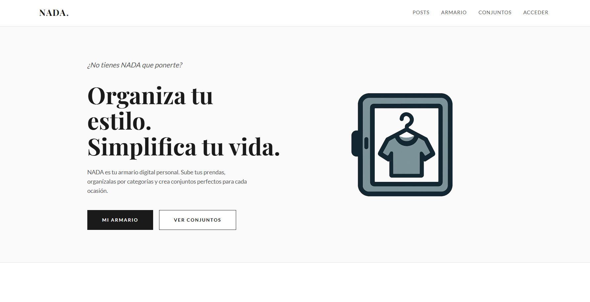
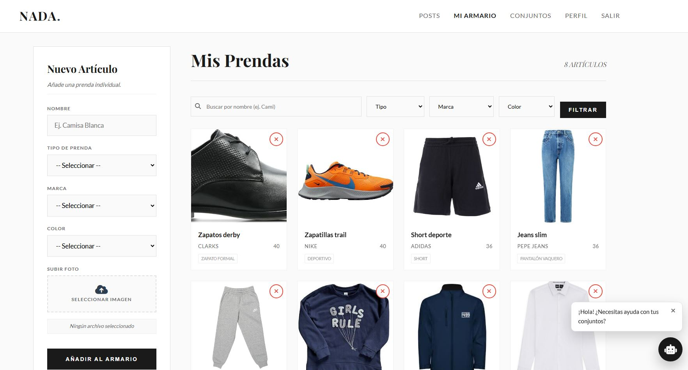
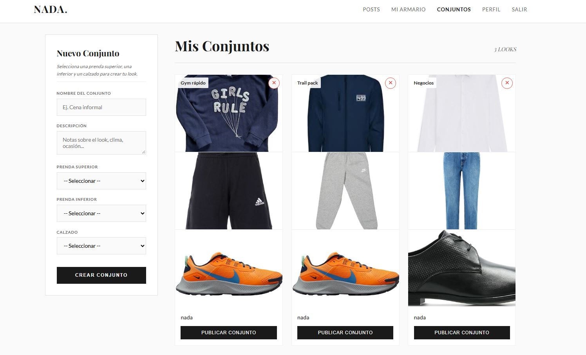

# NADA — Virtual Wardrobe

<p align="center">
  
</p>

*Nothing to wear?*

NADA is a web application for managing a personal digital wardrobe. Users can upload and organize their clothing, create outfits, and share their combinations with others.

Developed as a collaborative university project at the University of Extremadura.

## Screenshots

<p align="center">
  
</p>

| Virtual Wardrobe | Outfit Management |
|:---:|:---:|
|  |  |

## Technologies

- **Backend:** Java 21, Spring Boot 3.5.6, Spring MVC, Spring Data JPA, Hibernate
- **Frontend:** Thymeleaf, HTML, CSS, JavaScript
- **Database:** MySQL 8.4
- **Tools:** Maven, Docker, Docker Compose
- **Testing:** JUnit 5, Spring Boot Test, H2

## Features

- **User accounts:** Registration, login and personal wardrobes.
- **Clothing management:** Upload images, organize items by type, category, brand, color and size, and search or filter clothing.
- **Outfit creation:** Combine clothing items into outfits and save, edit or delete them.
- **Social features:** Publish outfits, browse other users' posts and like their combinations.
- **Outfit assistant:** Receive outfit suggestions based on clothing available in the user's wardrobe.

## Architecture

NADA follows the **Model–View–Controller (MVC)** pattern with a layered Spring Boot architecture:

- **Controllers:** Handle HTTP requests and return Thymeleaf views.
- **Services:** Implement business logic.
- **Repositories:** Manage database access through Spring Data JPA.
- **Models:** Represent users, clothing items, outfits and posts.

```text
HTTP Request → Controller → Service → Repository → MySQL
```

The application runs in a Docker container alongside a separate MySQL container.

### Database Design

<p align="center">
  
</p>

## Running Locally

### Requirements

- Docker and Docker Compose (included in Docker Desktop)

### Setup

1. Clone the repository:

```bash
git clone https://github.com/MDAI-UEx/nada-virtual-wardrobe.git
cd nada-virtual-wardrobe
```

2. Build and start the containers:

```bash
docker compose up -d --build
```

3. Once the database schema has been created, import the sample data from `src/main/resources/data.sql`:

```bash
docker exec -i mysql_db mysql -u nada -p -h 127.0.0.1 --protocol=tcp --default-character-set=utf8mb4 nada < src/main/resources/data.sql
```

Enter the MySQL password configured for the local Docker environment when prompted.

**Note:** Import the sample data before registering additional users, as the initial records depend on predefined identifiers.

The sample account is:

- **Username:** `fran`
- **Password:** `fran123`

4. Open the application at **http://localhost:8080**.

### Docker Commands

```bash
# Start existing containers
docker compose up -d

# Stop containers
docker compose down

# Reset database and volumes
docker compose down -v
```

Resetting the database removes stored data. Restart the containers and import the sample data again if needed.

## Testing

Automated tests use **JUnit 5, Spring Boot Test and H2**, with a dedicated test profile.

The test suite covers models, repositories, services and application requirements.

Run the tests with Java 21 and Maven:

```bash
mvn test
```

## Team

Developed by:

- **Francisco Montero Sánchez** — [GitHub](https://github.com/fmonteroi)
- **Ana Montero Preciado** — [GitHub](https://github.com/amonterooq)
